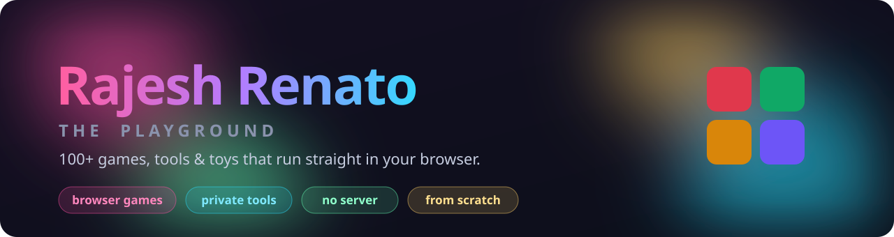

  

  
  
  
  

<h3 align="center">🎮 The Playground — 100+ games, tools &amp; toys</h3>

All in the browser, no sign-up, nothing to install → <a href="https://rajeshrenato.github.io/">rajeshrenato.github.io</a>

<b>🕹️ Games</b>

<table align="center">
  <tr>
    <td align="center" width="265">
      <a href="https://rajeshrenato.github.io/highway-brawl/"> <b>Highway Brawl</b></a> bike combat racing, online
    </td>
    <td align="center" width="265">
      <a href="https://rajeshrenato.github.io/battle-tanks/"> <b>Battle Tanks</b></a> defend the eagle, 1v1 online
    </td>
    <td align="center" width="265">
      <a href="https://rajeshrenato.github.io/miami-nights/"> <b>Miami Nights</b></a> an open-world driver
    </td>
  </tr>
</table>

<b>🧰 Tools</b>

<table align="center">
  <tr>
    <td align="center" width="265">
      <a href="https://rajeshrenato.github.io/secret-chat/"> <b>Secret Chat</b></a> encrypted chat, no server
    </td>
    <td align="center" width="265">
      <a href="https://rajeshrenato.github.io/photo-privacy/"> <b>Photo Privacy</b></a> strip location &amp; EXIF
    </td>
    <td align="center" width="265">
      <a href="https://rajeshrenato.github.io/qr-studio/"> <b>QR Studio</b></a> QR codes with your logo
    </td>
  </tr>
</table>

No engines, no asset files — every texture, sprite, and sound is generated in code.

<h3 align="center">🖥️ Desktop apps</h3>
<table align="center">
  <tr>
    <td align="center" width="230">
      <a href="https://rajeshrenato.github.io/open-sortlet/"> <b>Sortlet</b></a> 
      Your inbox, sorted by AI, on your own computer
    </td>
    <td align="center" width="230">
      <a href="https://rajeshrenato.github.io/open-priority-matrix/"> <b>Priority Matrix</b></a> 
      A calm Eisenhower matrix for your tasks
    </td>
    <td align="center" width="230">
      <a href="https://rajeshrenato.github.io/open-perch/"> <b>Perch</b></a> 
      A clipboard manager for your menu bar
    </td>
  </tr>
</table>

<h3 align="center">📦 Published</h3>

<b>VS&nbsp;Code extensions</b> &nbsp;·&nbsp; 8,000+ installs on the Marketplace

  
  
  

<b>npm packages</b>

  
  

<h3 align="center">🧩 More to explore</h3>

  <b>Play online, no server:</b>
  <a href="https://rajeshrenato.github.io/chess/">Chess</a> ·
  <a href="https://rajeshrenato.github.io/ludo/">Ludo</a> ·
  <a href="https://rajeshrenato.github.io/clue-grid/">Clue Grid</a> ·
  <a href="https://rajeshrenato.github.io/sketch-guess/">Sketch &amp; Guess</a> ·
  <a href="https://rajeshrenato.github.io/trivia-night/">Trivia Night</a>
   
  <b>Private tools that never upload:</b>
  <a href="https://rajeshrenato.github.io/pdf-toolkit/">PDF Toolkit</a> ·
  <a href="https://rajeshrenato.github.io/images-to-pdf/">Images to PDF</a> ·
  <a href="https://rajeshrenato.github.io/photo-privacy/">Photo Privacy</a> ·
  <a href="https://rajeshrenato.github.io/file-send/">File Send</a> ·
  <a href="https://rajeshrenato.github.io/screen-recorder/">Screen Recorder</a>

<h3 align="center">🛠️ Built with</h3>

  
  
  
  
  
  
  
  

<h3 align="center">🔥 By the numbers</h3>

  

Everything above is MIT-licensed and readable with View Source · <a href="https://github.com/RajeshRenato/RajeshRenato.github.io">source on GitHub</a>

